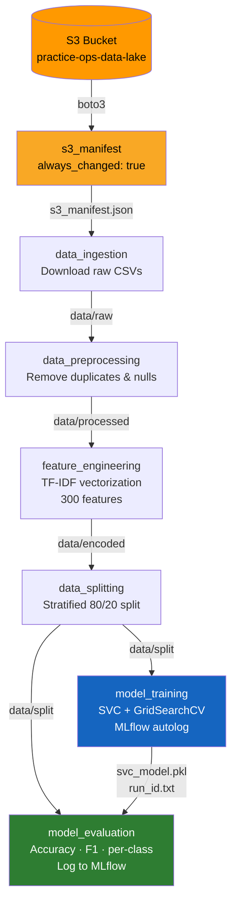

# News Classification Pipeline

End-to-end ML pipeline for news article classification using DVC for reproducibility, MLflow for experiment tracking, and S3 for remote storage.

## Pipeline Architecture



### Stages

| # | Stage | Input | Output | Key Detail |
|---|-------|-------|--------|------------|
| 1 | **s3_manifest** | S3 bucket | `data/s3_manifest.json` | Always runs; detects new uploads via ETag |
| 2 | **data_ingestion** | `s3_manifest.json` | `data/raw/` | Downloads all CSVs via boto3 |
| 3 | **data_preprocessing** | `data/raw/` | `data/processed/` | Drops duplicates & null rows |
| 4 | **feature_engineering** | `data/processed/` | `data/encoded/` | Snowball stemmer + TF-IDF (300 features) |
| 5 | **data_splitting** | `data/encoded/` | `data/split/` | Stratified split on `label` column |
| 6 | **model_training** | `data/split/train.csv` | `models/svc_model.pkl` | GridSearchCV over C, kernel, gamma |
| 7 | **model_evaluation** | `data/split/test.csv` + model | MLflow metrics | Accuracy, F1 macro/weighted, per-class |

## Stack

DVC (pipeline orchestration) · MLflow (experiment tracking) · S3 (remote storage) · scikit-learn (SVC + TF-IDF) · NLTK (text preprocessing) · boto3 (AWS SDK) · uv (dependency management)

## Project Structure

```
news-classification/
├── pipeline/
│   ├── s3_manifest.py          # S3 object listing → manifest JSON
│   ├── data_ingestion.py       # Download raw data from S3
│   ├── data_preprocessing.py   # Clean duplicates & nulls
│   ├── feature_engineering.py  # Text transform + TF-IDF
│   ├── data_splitting.py       # Train/test split
│   ├── model_training.py       # SVC training + MLflow logging
│   ├── model_evaluation.py     # Evaluation metrics + MLflow
│   └── pipeline_utils.py       # Shared logger & config loader
├── data/
│   ├── raw/                    # Downloaded S3 files
│   ├── processed/              # Cleaned data
│   ├── encoded/                # TF-IDF encoded features
│   ├── split/                  # train.csv + test.csv
│   └── s3_manifest.json        # S3 state snapshot
├── models/
│   ├── svc_model.pkl           # Trained SVC model (~13.6MB)
│   └── run_id.txt              # MLflow run identifier
├── dvc.yaml                    # Pipeline DAG definition
├── dvc.lock                    # Locked hashes for reproducibility
├── params.yaml                 # Pipeline configuration
└── pyproject.toml              # Dependencies
```

## Setup

### Prerequisites

- Python 3.14+
- [uv](https://docs.astral.sh/uv/) package manager
- AWS credentials configured (`~/.aws/credentials` or env vars)
- Access to S3 buckets: `practice-ops-data-lake` (data) and `dvc-remote-news-classification` (DVC remote)

### Install

```bash
git clone https://github.com/RafatMeraz/news-classification.git
cd news-classification
uv sync
```

### Configure AWS

```bash
aws configure
# Enter: AWS Access Key ID, Secret Access Key, region
```

### Run Pipeline

```bash
# Run full pipeline
dvc repro

# Run specific stage
dvc repro data_ingestion

# Check pipeline status
dvc status
```

### Pull Cached Data (skip re-computation)

```bash
dvc pull
```

### View Experiments

```bash
mlflow ui --backend-store-uri sqlite:///mlflow.db
# Open http://localhost:5000
```

## Configuration

All pipeline parameters live in `params.yaml`:

```yaml
data_ingestion:
  bucket_name: practice-ops-data-lake   # Source S3 bucket

split:
  test_size: 0.2                        # 20% held out for test
  random_state: 42

model_train:
  cv: 2                                 # GridSearchCV folds
  scoring: accuracy
  n_jobs: -1                            # Use all CPU cores

model_evaluation:
  model_path: models/svc_model.pkl

utils:
  data_folder: data
```

Changing any param triggers that stage and all downstream stages to re-run automatically.

## Model Training

GridSearchCV over SVC hyperparameters:

| Hyperparameter | Search Space |
|----------------|-------------|
| `C` | 0.1, 1, 10, 100 |
| `kernel` | linear, rbf |
| `gamma` | scale, auto |

Best parameters and cross-validation scores are logged to MLflow automatically via `mlflow.sklearn.autolog()`.

## S3 Change Detection

The `s3_manifest` stage runs on every `dvc repro` call and writes a JSON snapshot of all S3 objects (key, ETag, size, last_modified). Since `data_ingestion` depends on this file, any new upload or modification to the S3 bucket automatically triggers re-ingestion and the full downstream pipeline.

## API Service

A FastAPI inference service that exposes the trained model for real-time news classification.

### Purpose

Accepts raw news text, applies the same preprocessing and TF-IDF encoding used during training, and returns a predicted category. Loads the latest registered model version from MLflow automatically.

### Prerequisites

Pipeline must be fully run at least once so the following exist:
- `models/svc_model.pkl` — trained SVC model
- `models/tfidf_vectorizer.pkl` — fitted TF-IDF vectorizer (generated by `feature_engineering` stage)
- `mlflow.db` — MLflow tracking database with registered model

### Start the API

```bash
uv run uvicorn src.news_classification.main:app --reload
# Server runs at http://localhost:8000
# Interactive docs at http://localhost:8000/docs
```

### Classify a news article

```bash
curl -X POST http://localhost:8000/classifier/ \
  -H "Content-Type: application/json" \
  -d '{"text": "Apple reports record quarterly earnings driven by iPhone sales"}'
```

Response:

```json
{"category_id": 2, "category_name": "Business"}
```

### Label Map

| ID | Category |
|----|----------|
| 0 | World |
| 1 | Sports |
| 2 | Business |
| 3 | Science/Technology |

### Request / Response Schema

| Field | Type | Description |
|-------|------|-------------|
| `text` | `string` | Raw news article text |
| `category_id` | `int` | Predicted label (0–3) |
| `category_name` | `string` | Human-readable category |

All requests and responses are logged to `logs/api.log`.

---

## Remote Storage

DVC remote is configured at `s3://dvc-remote-news-classification`:

```bash
# Push artifacts to remote
dvc push

# Pull artifacts from remote
dvc pull
```